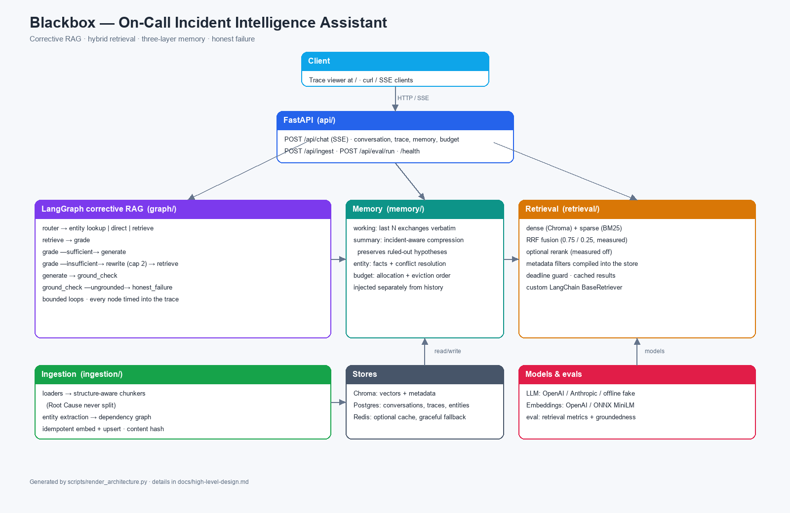

# Blackbox — On-Call Incident Intelligence Assistant

Ask questions against a corpus of past incidents, runbooks, architecture docs and alert
definitions: *"checkout p99 is spiking and the DB connection pool looks saturated — has this
happened before?"*

Phases 0–9 complete. See `docs/` for design, planning and results; `docs/phase-wise-plan.md`
tracks progress.

## Status

| Phase | Scope | State |
|---|---|---|
| 0 | Scaffolding, config, logging, health endpoints | ✅ |
| 1 | 60-document corpus, structure-aware chunking, entity extraction | ✅ |
| 2 | Hybrid retrieval, fusion, reranking, metadata filtering, eval harness | ✅ |
| 3 | LangGraph corrective-RAG graph: routing, grading, bounded rewrite, ground check | ✅ |
| 4 | Three-layer memory, conflict resolution, token budget | ✅ |
| 5 | API + SSE streaming, conversation persistence, trace endpoints | ✅ |
| 6 | Trace viewer UI | ✅ |
| 7 | Groundedness eval + abstention measurement | ✅ |
| 8 | Observability, caching, hardening | ✅ |
| 9 | Architecture diagram, demo script, submission pass | ✅ |

## Production development

The original assignment is complete. Work beyond it is tracked in two living documents:

- [`docs/scaling-and-production-readiness.md`](docs/scaling-and-production-readiness.md) —
  target architecture, capacity/SLOs, tenancy, retrieval/index lifecycle, Kubernetes,
  multi-region and the phased production plan.
- [`docs/development-tracker.md`](docs/development-tracker.md) — phase-by-phase checklist,
  status dashboard, decision log and change log. Update this file with every production PR.
- [`deploy/helm/blackbox`](deploy/helm/blackbox) and
  [`deploy/observability`](deploy/observability) — the Helm deployment package and the
  Prometheus metric/alert contract.
- [`deploy/terraform`](deploy/terraform) and [`deploy/external-secrets`](deploy/external-secrets)
  — the AWS reference infrastructure and the External Secrets wiring for the chart.

Open defects and scaling gaps found by the code audit (all reproduced against the running
code) are collected in
[`docs/code-audit-findings.md`](docs/code-audit-findings.md). **All nine findings are now
fixed**, including the critical one where the SSE token stream exposed an answer before the
ground check had run.

Current production phase: **Phase 4 (Kubernetes and operations) — in progress**. Phase 3
(async runtime and jobs) is complete: async store interfaces (`asearch`), SSE cancellation on
client disconnect, a shared Redis job store with a handler registry and a dedicated worker
process (`python -m blackbox.worker`), staged ingest with validation before the alias swap,
and the trace store split (Postgres recent + file/S3 archive, paginated `/trace`,
archive-before-prune retention).
Phase 2 (retrieval migration and data-plane tenant isolation) is functionally complete:
tenant isolation, RLS, Qdrant adapter, versioned indexes, shadow indexing/dual-read,
offboarding, retention, partition plan and eval parity gate landed; only the live-cluster
backend benchmark and global quotas remain.

Phase 4 progress so far:
- **Deployment package:** [`deploy/helm/blackbox`](deploy/helm/blackbox) — API and worker
  Deployments, `alembic upgrade head` pre-upgrade Job, startup/readiness/liveness probes,
  HPA, KEDA worker scaling on queue depth, PodDisruptionBudgets, topology spread, optional
  SSE-correct Ingress, NetworkPolicies, ServiceMonitor, and an unprivileged image.
- **Metrics and SLOs:** a dependency-free Prometheus registry and `/metrics` endpoint
  (`blackbox_http_*`, `blackbox_sse_active_streams`, retrieval stages, LLM calls/tokens/errors,
  job queue depth), with recording and multi-window burn-rate alert rules in
  [`deploy/observability`](deploy/observability).
- **Tracing:** optional OpenTelemetry spans over the same request path
  (`http.request` → `chat.turn` → `graph.node.*` → `retrieval.retrieve` / `llm.complete` →
  `db.record_turn`). A no-op unless `OTEL_ENABLED=true` and the `otel` extra is installed;
  trace ids are bound into structured logs. OTLP/HTTP exports to a collector.
- **Dashboards and stack configs:** [`deploy/observability`](deploy/observability) — a
  Grafana overview dashboard pinned to the metric contract, Prometheus/Loki/Tempo
  datasource provisioning, an OTel Collector pipeline, Tempo/Loki references and Promtail
  values that extract `trace_id` for log↔trace links.
- **AWS reference infrastructure:** [`deploy/terraform`](deploy/terraform) — VPC with flow
  logs, EKS (private endpoint by default, CMK-encrypted Secrets, tainted batch node group),
  Aurora PostgreSQL 16 with an RDS-managed password, ElastiCache Redis with TLS and
  `noeviction`, a versioned KMS-encrypted S3 trace archive, and split IRSA roles for the app
  and External Secrets. `terraform validate`- and Trivy config-clean; not applied (no AWS
  account available here).
- **Secrets:** [`deploy/external-secrets`](deploy/external-secrets) assembles the chart's
  `existingSecret` from Secrets Manager, including the RDS-managed credential and the KEDA
  password key.
- **CI:** coverage gate, chart lint/render with kubeconform, Terraform fmt/validate + Trivy
  config, image build, Trivy scan and SPDX SBOM.
Still open in Phase 4: GitOps/canary delivery, load and failure-injection suites, global
per-tenant quotas, and the pen-test/secret-rotation checklists. OpenSearch/Qdrant are added
to Terraform once the backend benchmark decides their shape.
Production Phase 1 (control-plane auth, shared limits, resilience, migrations, multi-pod
smoke) is complete, and the code-audit remediation is complete: the SSE token stream is
emitted only after the ground check, retrieval timings are per-request, the budget endpoint
reports the request that was actually sent, the graph runs asynchronously without holding a
worker thread, and ingest/eval run as background jobs.

## Architecture



Client → FastAPI → corrective-RAG graph, with memory, hybrid retrieval, ingestion and the
optional stores. Full narrative in `docs/high-level-design.md`; regenerate the image with:

```bash
pip install -e ".[docs]"
python scripts/render_architecture.py
```

## Quick start

```bash
cp .env.example .env

# Project-local environment (nothing installed globally)
python -m venv .venv
source .venv/bin/activate            # Windows: .\.venv\Scripts\Activate.ps1
pip install -e ".[dev,rag,db]"

pytest -q                            # 465 tests
uvicorn blackbox.main:app --reload
```

`db` is required locally as well as in Docker: the conversation store and entity store use
SQLAlchemy, and `postgresql://` resolves to psycopg 3.

Then seed the corpus once (idempotent). Ingestion is a background job, so the call
answers `202` with a job id:

```bash
curl -X POST localhost:8000/api/ingest \
  -H 'content-type: application/json' \
  -d '{"corpus_dir":"seed/corpus"}'
# -> {"job_id":"...","kind":"ingest","status":"queued","status_url":"/api/ingest/..."}

curl localhost:8000/api/ingest/<job_id>   # -> {"status":"succeeded","result":{...}}
```

Open `http://localhost:8000/` for the trace viewer.

Traces are paginated (`?limit=&offset=`) and can include the archived window
(`?include_archive=true`). Retention prunes old turns, but only after archiving them when
an archive backend is configured:

```bash
curl -X POST 'localhost:8000/api/admin/retention?days=90&archive=true'
# queue it instead (202 + job id): &background=true
```

With `REDIS_URL` set, ingest/eval/retention jobs go through a shared queue, so any replica
or a dedicated `python -m blackbox.worker` process can execute them. Archiving uses
`TRACE_ARCHIVE_BACKEND=file` (default path `./data/traces`) or `s3` (install the `archive`
extra for boto3).

Run the scripted demo conversation (nine turns + a no-answer question):

```bash
python scripts/demo_chat.py --base-url http://localhost:8000
```

The recording outline is in [`docs/demo-script.md`](docs/demo-script.md).

No API key is required to run retrieval. Dense embeddings fall back to Chroma's bundled
ONNX MiniLM model, so the corpus, the tests and the eval harness all work offline. Set
`OPENAI_API_KEY` and `retrieval.embedding_provider: openai` to switch to a hosted model.

## Run with Docker

```bash
cp .env.example .env
docker compose up --build
curl http://localhost:8000/health
```

## Retrieval

`blackbox/retrieval/` — dense and sparse retrieval run in parallel, fuse, then optionally
re-rank. Every stage records its own score and rank on each chunk, which is what the trace
viewer renders.

| File | Role |
|---|---|
| `dense.py` | Cosine similarity over Chroma; distance converted to similarity |
| `sparse.py` | In-process BM25 with an identifier-preserving tokenizer |
| `fusion.py` | RRF and normalized weighted sum, both config-driven |
| `rerank.py` | Lexical, cross-encoder, LLM, or null — selectable and measured |
| `filters.py` | Metadata filters compiled to native Chroma predicates |
| `hybrid_retriever.py` | The custom LangChain `BaseRetriever` composing all of the above |
| `timeout.py` | Deadline guard so a slow store cannot hang a request |

Everything is configurable in `blackbox/config/config.yaml` — weights, top-k, fusion method,
rerank provider, timeout — with no code changes.

### Using it

```python
from blackbox.retrieval import build_default_retriever, MetadataFilter

retriever = build_default_retriever()

hits = retriever.retrieve("ERR_POOL_EXHAUSTED in checkout-service", top_k=5)
for h in hits:
    print(h.metadata["doc_id"], h.metadata["section"], round(h.score, 4))

# Filtering happens inside the store, not after the fact.
sev1 = retriever.retrieve(
    "connection pool exhaustion",
    top_k=5,
    filter=MetadataFilter(services=["checkout-service"], severities=["SEV1"]),
)

# It is a real LangChain retriever, so it composes.
from langchain_core.runnables import RunnableLambda
chain = retriever | RunnableLambda(lambda docs: [d.metadata["doc_id"] for d in docs])
```

### Retrieval results

Measured on the seeded 60-document corpus with a 35-question eval set. Full table,
per-category breakdown and the fusion weight sweep are in
[`docs/retrieval-results.md`](docs/retrieval-results.md).

| Strategy | MRR | Recall@5 | Precision@5 |
|---|---|---|---|
| dense-only | 0.8548 | 0.8581 | 0.4433 |
| sparse-only (BM25) | 0.8714 | 0.8510 | 0.3786 |
| hybrid (RRF) | **0.9167** | **0.8867** | **0.4348** |
| hybrid + rerank | 0.8857 | 0.9219 | 0.4543 |

Two results are reported as measured rather than as hoped:

- **Reranking is disabled by default.** It lowered MRR by 0.031 on this corpus while
  raising recall. It is implemented and selectable per request.
- **Dense-only and BM25 tie on exact-token queries here** (0.90 vs 0.90), rather than the
  usual expectation that only BM25 can match an identifier literally. The seeded documents
  are short and templated, so identifiers appear in tight, repeated contexts that MiniLM
  encodes well. The reasoning and the data are in `docs/retrieval-results.md`.
- **The metric's last decimal place is not a finding.** The BM25 leg returns groups of
  documents that score identically, and the order inside a group is decided by the
  tie-break. Re-running with only the tie-break changed moves MRR by 0.0286, which is
  larger than most of the differences in the table above.

Reproduce:

```bash
python scripts/build_eval_dataset.py          # derive the question set from the corpus
python -m blackbox.eval.retrieval_eval --k 5 --write --fusion-sweep --tie-break-sweep
```

### Groundedness and abstention

Full results in [`docs/groundedness-results.md`](docs/groundedness-results.md).

| Metric | Value |
|---|---|
| Answer rate (35 answerable) | **0.8857** (31/35) |
| Abstention accuracy (5 unanswerable) | **1.0000** (5/5) |
| Draft claim support | **1.0000** (31/31) |
| Unsupported claims stripped | 0 |

Draft claim support is measured on the claims the generator drafted, *before* the ground
check strips unsupported ones — otherwise the metric would be a tautology. The offline
extractive provider is grounded by construction, so the 1.0 here is a floor; re-run with a
hosted model to measure real overreach. All four answer failures are `paraphrase` questions,
matching the retrieval-table finding for this templated corpus.

Reproduce:

```bash
python -m blackbox.eval.groundedness_eval --write
```

## Graph

`blackbox/graph/` — a corrective-RAG pipeline built as a LangGraph `StateGraph`:

```
router ─┬─ entity ── entity_lookup ─────────────────┐
        ├─ direct ── direct_answer ── END           │
        └─ retrieve ── grade ─┬─ sufficient ────────┤
                    ▲         ├─ rewrite ── retrieve│
                    └─────────┴─ cap reached ── honest_failure
                                                       │
                        generate ── ground_check ──────┤
                                    └─ ungrounded ─────┘
```

| File | Role |
|---|---|
| `state.py` | JSON-serialisable state; every chunk keeps its full retrieval score trail |
| `router.py` | Deterministic routing; defaults to retrieval, entity lookup for known-service dependencies, direct only for greetings, capabilities and glossary definitions |
| `nodes.py` | Retrieve, grade, rewrite, generate, ground check, honest failure |
| `grounding.py` | Deterministic claim→chunk tracing; unsupported claims are stripped |
| `build.py` | Graph assembly plus sync and streaming runners |

Every node appends a timing/decision event to `state["trace"]`, and
`stream_graph_events()` yields those events as they happen for the API and trace viewer.
Rewrites are bounded by `retrieval.rewrite_cap` (default 2); hitting the cap produces an
honest failure that states the query, filters and what was searched.

```python
from blackbox.graph import build_graph, initial_state, run_graph
from blackbox.retrieval import build_default_retriever

retriever = build_default_retriever()
graph = build_graph(retriever)          # offline provider when no API key is set
result = run_graph(graph, initial_state("What caused ERR_POOL_EXHAUSTED in checkout-service?"))

print(result["status"])                 # answered | honest_failure | direct
print(result["answer"])
print([event["node"] for event in result["trace"]])
```

`blackbox/llm/` is the provider seam: `complete()` is the only method the graph calls,
with OpenAI and Anthropic implementations plus a deterministic offline provider (lexical
grading, extractive generation, identifier-preserving rewriting). `LLM_PROVIDER=openai`,
`anthropic`, `fake` or `auto` selects it; `auto` falls back to the offline provider when no
key is present in dev and fails loudly in prod.

## Memory

`blackbox/memory/` — three layers plus one shared token budget:

| File | Role |
|---|---|
| `models.py` | `EntityMemory`: facts, actions, timeline; hypotheses update in place on contradiction and keep an audit history |
| `working.py` | Last N exchanges verbatim |
| `summary.py` / `prompts.py` | Cumulative incident-aware compression; explicitly preserves ruled-out hypotheses, confirmed facts, actions and timeline anchors |
| `conversation.py` | Trigger policy (`summary_trigger_turns`) and layering; JSON round-trip |
| `context.py` | Budgeted assembly and the documented eviction order |
| `tokens.py` | tiktoken counting/truncation with an offline fallback |

```python
from blackbox.memory import ConversationMemory, build_context

memory = ConversationMemory(config.memory)
memory.entity.upsert_hypothesis("01:15 deploy", status="ruled_out", evidence="no code diff")
memory.add_turn("checkout p99 is spiking", "checking pool metrics")
memory.maybe_compress(llm, model=settings.grading_model)

bundle = build_context(
    system_prompt=SYSTEM_PROMPT,
    memory=memory,
    chunks=hits,
    question=question,
    budget=config.budget,
)
result = run_graph(
    graph, initial_state(question, context=bundle.render(), budget=bundle.report)
)
```

Injection order is entity → summary → recent turns → retrieved chunks → question. On
overflow the eviction order is oldest recent turns → lowest-score chunks → summary
compression → entity essentials; the system prompt is never evicted. `bundle.report` is the
same accounting exposed by `/budget` in Phase 5, and `ConversationMemory.to_dict()` is the
persistence shape.

## API

`blackbox/api/` — the streaming surface over the graph and memory.

| Endpoint | Purpose |
|---|---|
| `POST /api/chat` | SSE: node events, ground-checked token events, final state |
| `GET /api/conversations/:id` | Conversation summary (turn count, last status) |
| `GET /api/conversations/:id/trace` | Per-turn graph trace with chunk scores and budgets |
| `GET /api/conversations/:id/memory` | Entity facts, summary, working turns |
| `GET /api/conversations/:id/budget` | Last turn's token allocation |
| `POST /api/ingest` | Idempotent corpus ingest (`{"corpus_dir","refresh"}`); `202` + job id |
| `POST /api/eval/run` | Retrieval metrics; `groundedness:true` adds claim-support/abstention; `202` + job id |
| `GET /api/jobs/:id` | Background job status and result |
| `GET /api/ingest/:id` | Ingest job status and result |
| `GET /api/eval/:id` | Eval job status and result |

```bash
curl -N -X POST localhost:8000/api/chat \
  -H 'content-type: application/json' \
  -d '{"message":"What caused ERR_POOL_EXHAUSTED in checkout-service?"}'
```

The SSE sequence is `node` (graph path as it executes) → `token` (the answer, emitted only
after ground check) → `final` (status, route, trace, chunk score trails, grade, ground check,
budget, conversation id). The turn is persisted before `final` is emitted. Errors mid-stream
arrive as an `error` event.

Persistence uses `DATABASE_URL` (Postgres in Docker). In dev, if the configured DB is
unreachable the service falls back to SQLite under `data/`; in prod an unavailable DB is a
503. One active turn per conversation is enforced (409), and ingest/eval runs are serialised.

> Token events are transport chunks of the already-verified answer, not raw provider decode
> tokens: answer text is deliberately withheld until ground check passes.

### Caching, limits and hardening

- **Optional caching.** Redis is used when reachable; otherwise an in-process TTL cache is
  the fallback. Embeddings and repeated identical retrievals are cached (retrieval keys
  include query, filters, top-k and fusion config, and are cleared on ingest). Dev-only LLM
  response caching keys on provider/model/prompt/temperature/max-tokens/JSON mode and is
  never used by the eval harnesses. A cache failure is a miss, never an error.
- **Rate limiting.** Redis-backed fixed-window limiter shared across replicas when Redis is
  reachable, with an in-process fallback; health/viewer are exempt; 429 includes `Retry-After`.
- **Idempotent chat.** Send `Idempotency-Key` on `/api/chat` to replay the stored final
  response instead of running the turn again (in-flight dedupe is still pending).
- **CORS.** Set `CORS_ORIGINS` to a comma-separated allowlist. Empty disables CORS; `*` is
  rejected when `ENV=prod`.
- **Prompt injection.** Heuristics flag and log suspected injection and return the labels in
  the final SSE payload. Set `guardrails.strict_injection_block: true` to reject with 400.
- **Concurrency.** One active turn per conversation (409). SQLite/dev uses an asyncio lock;
  Postgres uses a session advisory lock across workers.
- **Authentication and roles.** When `AUTH_ENABLED=true`, send `Authorization: Bearer
  <jwt>`. The token must carry `tenant_id` and roles (`viewer`/`operator`/`admin`). Ingest and
  eval require `admin`; chat requires `operator`; reads require `viewer`. Conversation
  access is tenant-scoped, so cross-tenant IDs return 404. Dev mode (`AUTH_ENABLED=false`)
  uses a local admin principal.
- **Config validation** fails at startup for impossible settings (compression trigger below
  the verbatim window, negative budgets/TTLs, zero rate limits, wildcard CORS in prod,
  missing auth in prod).

## Trace viewer

Served by the same process at `/` (alias `/ui`) — no build step, no Node toolchain.

- **Replay:** paste a conversation id to see every stored turn: graph path with per-node
  timings, retrieved chunks with dense/sparse/fused/rerank scores and ranks, grading
  attempts and reasons, rewrites, ground-check counts, and the token budget table with
  evictions.
- **Live:** type a question and watch the SSE stream: node chips appear as the graph
  executes, then the ground-checked answer streams in; the persisted turn reloads on finish.
- **Memory panel:** entity facts, cumulative incident summary and working turns for the
  selected conversation.

Chunk score trails are stored with each turn (`chunks_json`), so replay shows exactly what
the live turn saw rather than a reconstruction. The UI builds all data with `textContent`,
so messages, answers and entity values cannot inject HTML.

## Corpus

`seed/corpus/` — 60 deterministic documents (30 postmortems, 15 runbooks, 10 architecture
docs, 5 alert definitions), regenerable via `python seed/generate_corpus.py`. All four
document types share one service/error-code vocabulary so retrieval is measurable.

## Submission checklist

| Requirement | Location |
|---|---|
| Structure-aware chunking rationale | [`docs/chunking-strategy.md`](docs/chunking-strategy.md) |
| Three-layer memory + compression contract | [`docs/memory-design.md`](docs/memory-design.md) |
| Retrieval comparison + fusion sweep | [`docs/retrieval-results.md`](docs/retrieval-results.md) |
| Groundedness + abstention results | [`docs/groundedness-results.md`](docs/groundedness-results.md) |
| Architecture diagram | [`docs/architecture.png`](docs/architecture.png) |
| Demo video script | [`docs/demo-script.md`](docs/demo-script.md) |
| Re-runnable evals | `python -m blackbox.eval.retrieval_eval --write --fusion-sweep` · `python -m blackbox.eval.groundedness_eval --write` |

Reproduce from a clean environment:

```bash
python -m venv .venv && source .venv/bin/activate
pip install -e ".[dev,rag,db]"
pytest -q
python -m blackbox.eval.retrieval_eval --k 5 --write --fusion-sweep
python -m blackbox.eval.groundedness_eval --write
```

### Known limitations

- Hosted-provider **decode-level** token streaming is not wired; SSE token events are
  transport chunks emitted only after ground check, so unverified text never ships.
- The offline provider is extractive, so its groundedness number is a floor; use a hosted
  model for the generator's real overreach (the harness is unchanged).
- Rate limiting is Redis-backed (shared across replicas) with a local fallback; turn locks are
  Postgres advisory locks. Per-tenant turn admission control is per pod; global quotas remain
  on the Phase 4 backlog.
- The corpus is synthetic and templated; `paraphrase` retrieval is intentionally weak and
  reported as measured rather than tuned away.
- The cross-encoder reranker requires the optional `rerank` extra; without it the lexical
  reranker is used and the measured trade-off still holds.
- **Authentication is implemented but dev-disabled.** Set `AUTH_ENABLED=true` (and a JWT
  secret or JWKS URL) to enforce bearer-token auth and tenant scoping; production settings
  refuse to start without it. Postgres RLS and retrieval-store tenant filters are the Phase 2
  data-plane gate.
- `Content-Length` is capped before JSON parsing (`413`); chunked/streamed requests still
  need a hard body limit at the reverse proxy.
- Hosted LLM SDK calls receive the configured timeout/retries; a circuit breaker, jittered
  retries and bounded concurrency wrap the provider. The provider interface is async, and
  every graph node is a coroutine, so a hosted round trip does not occupy a worker thread.
- Readiness checks the conversation store; Redis is optional and its availability is
  reported only after the runtime is initialized.
- The rate limiter keys on the client address. Behind an ingress every request arrives from
  the proxy, so `X-Forwarded-For` is honoured — but only from a configured trusted proxy
  (`TRUSTED_PROXY_CIDRS`), so the header cannot be spoofed to dodge the limit.
- Ingestion, evaluation and retention are background jobs: `POST /api/ingest`,
  `POST /api/eval/run` and `POST /api/admin/retention?background=true` answer `202 {job_id}`
  and run on a worker, with status endpoints. With `REDIS_URL` set the queue is shared, so
  any replica or a dedicated `python -m blackbox.worker` process can execute the job.

## Tests

465 tests, `ruff` clean, `mypy` clean. Retrieval, graph, memory, cache and API tests run against a small in-file
corpus with a deterministic hashing embedder and the offline LLM provider, so they need no
network and no model download.

```bash
pytest -q
python -m ruff check blackbox tests scripts
```
