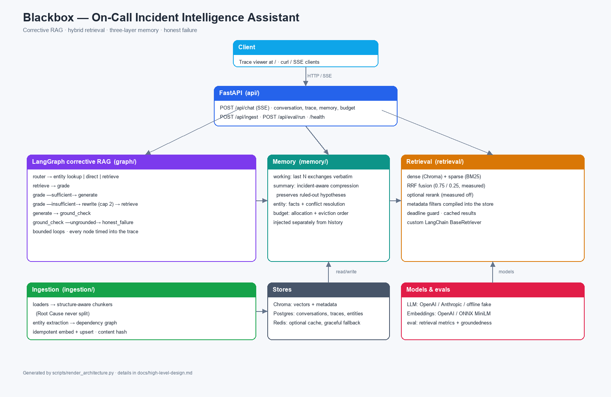

# High-Level Design — Blackbox



Generated diagram: [architecture.png](architecture.png) (regenerate with
`python scripts/render_architecture.py`).

## System Overview

Blackbox is a corrective-RAG assistant for on-call engineers. It answers incident questions against a corpus of postmortems, runbooks, architecture docs, and alert definitions. It is honest about retrieval failure and preserves critical facts across long conversations.

## Architecture Diagram (textual)

```
Client (Trace Viewer UI)
   |  SSE
   v
FastAPI (api/)
   |
   +-- /api/chat  --> LangGraph graph (graph/build.py)
   |                      |
   |                      +-- router node
   |                      |      |-- entity/graph lookup (Postgres)
   |                      |      |-- retrieval (hybrid retriever)
   |                      |      +-- direct answer (no retrieval)
   |                      +-- grade node (LLM)
   |                      +-- rewrite node (LLM, bounded)
   |                      +-- generate node (LLM)
   |                      +-- ground_check node (LLM)
   |                      +-- honest_failure node
   |
   +-- memory layer (memory/): working, summary, entity, budget
   +-- retrieval layer (retrieval/): dense, sparse, fusion, rerank, hybrid_retriever
   +-- ingestion layer (ingestion/): loaders, chunkers, entity_extraction, pipeline
   |
   v
Stores: Chroma (vectors), Postgres (structured + entity graph + conversations), Redis (cache),
        OpenSearch (sparse index, optional — the in-process BM25 index is the default)
```

## Component Responsibilities

- **Ingestion**: parse docs by type, structure-aware chunk, extract entities, upsert idempotently.
  It writes the dense collection and the sparse index together, on a background worker.
- **Retrieval**: hybrid dense+sparse, RRF fusion, metadata filter, rerank, timeout, custom retriever.
  The dense and sparse legs run concurrently, and the sparse leg is a store behind a
  protocol, so it can be the in-process BM25 index or an OpenSearch index.
- **Graph**: corrective RAG with routing, grading, bounded rewrite, ground check, honest failure, streaming.
  Every node is a coroutine, so a hosted LLM round trip does not occupy a worker thread.
- **Memory**: three layers + conflict resolution + token budgeting + eviction.
- **API**: REST + SSE, persistence, trace, memory, budget, ingest, eval, background jobs.
- **UI**: trace viewer.

## Data Flow — Chat Turn

1. Request arrives with conversation_id + message.
2. Load conversation state (working/summary/entity memory) from Postgres/Redis.
3. Token budget allocated (system, entity, summary, recent, chunks, output headroom).
4. Router decides path.
5. If retrieval: hybrid retriever runs (timeout-bounded), chunks injected into state.
6. Grade → rewrite loop (bounded).
7. Generate answer.
8. Ground check → strip/flag unsupported claims.
9. Honest failure if no relevant chunks.
10. Update entity memory + summary trigger.
11. Persist turn, trace, budget.
12. Stream events + tokens via SSE.

## Key Design Decisions

- Python + LangChain + LangGraph (per user choice).
- Chroma for vectors (simple, local), Postgres for structured/entity/conversation data, Redis optional for caching.
- RRF fusion default; weights config-driven and justified by eval.
- Bounded rewrite cap (default 2) defined in config.
- Entity memory updated (not appended) on conflict.
- All tunables externalized to config YAML + env.

## Scalability & Reliability

- Retrieval timeout prevents hanging vector store.
- LLM response caching in dev.
- Request id threaded through graph for tracing.
- Idempotent ingestion.
- Structured JSON logging.
